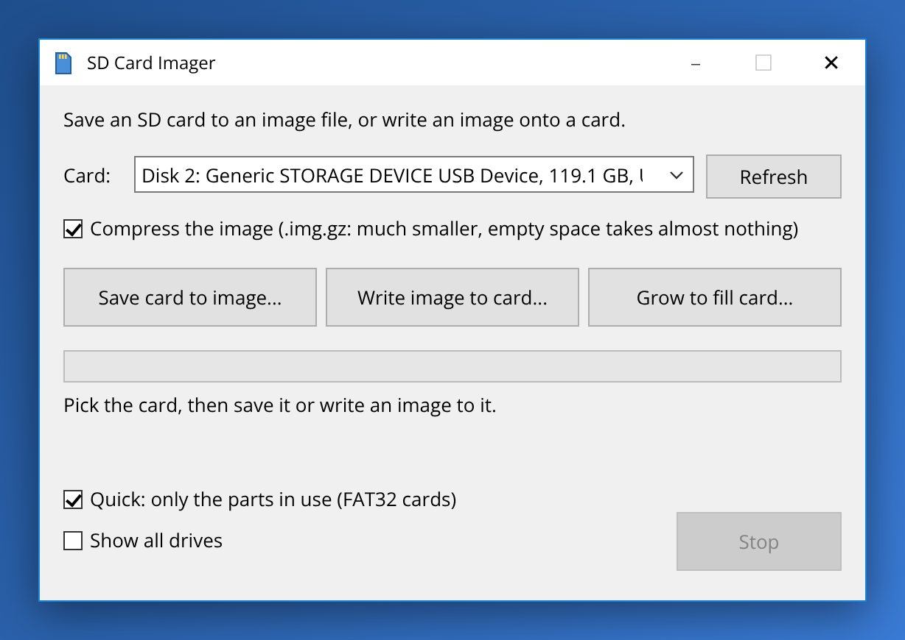
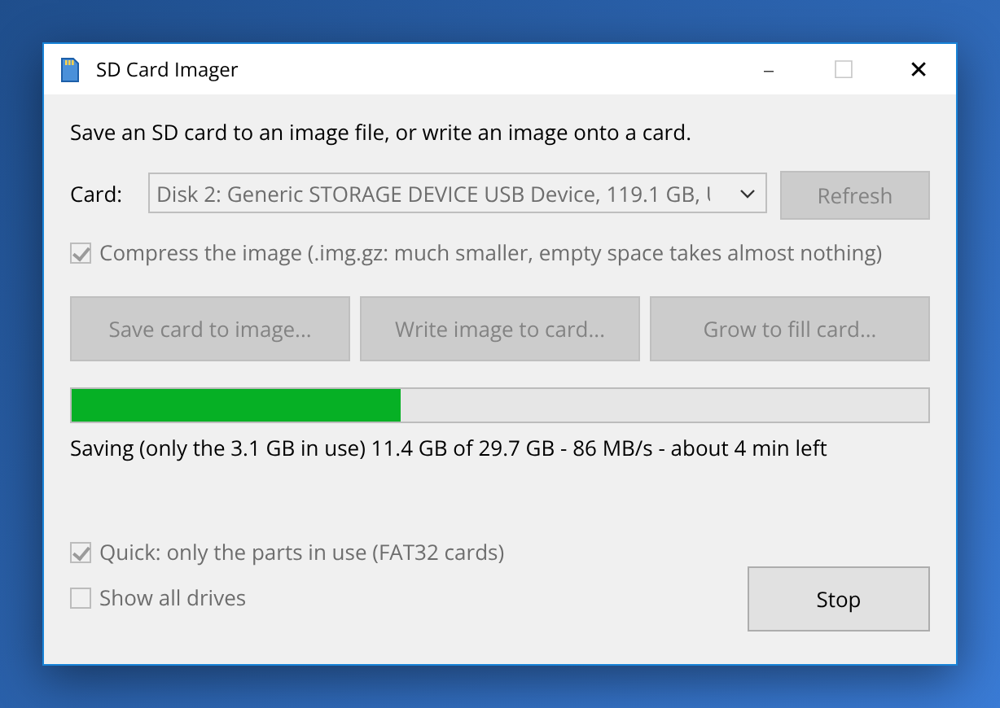
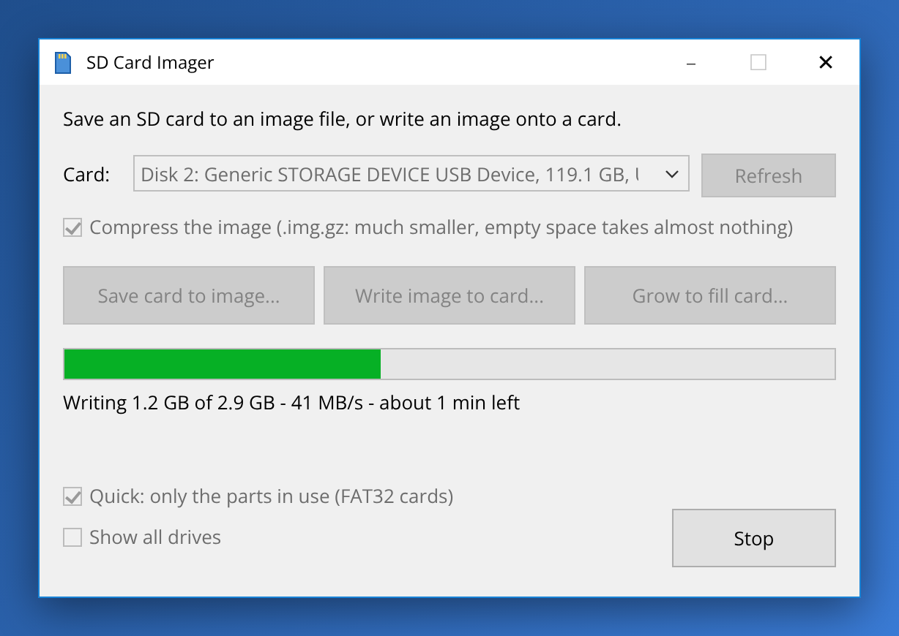
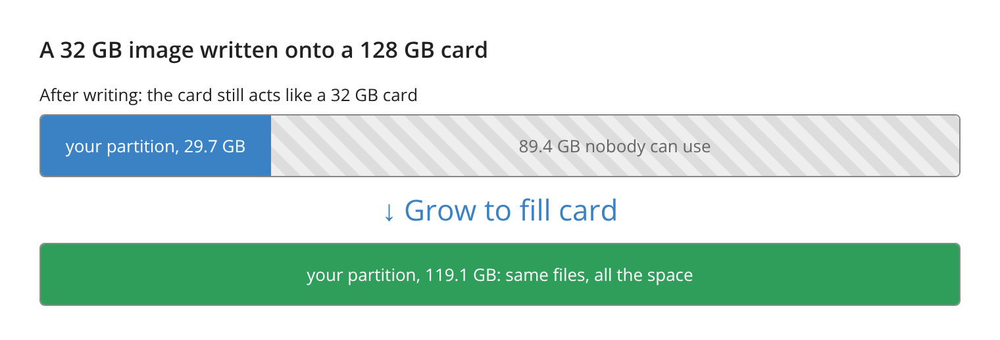
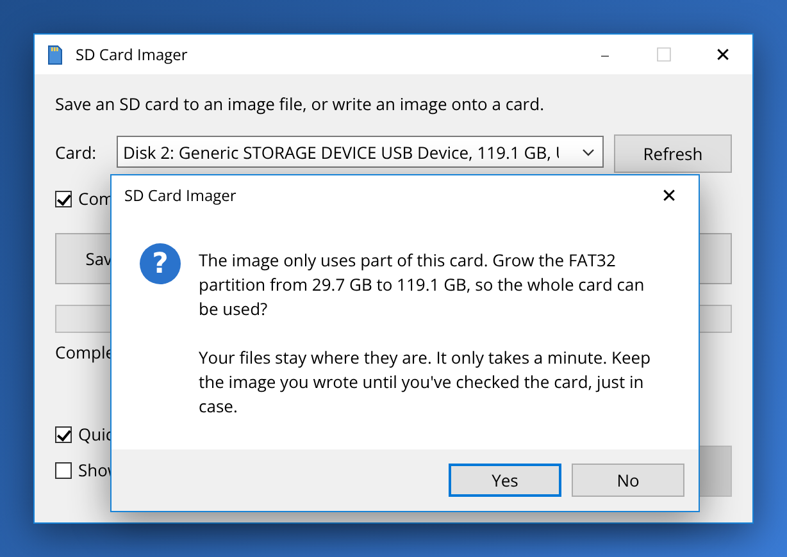
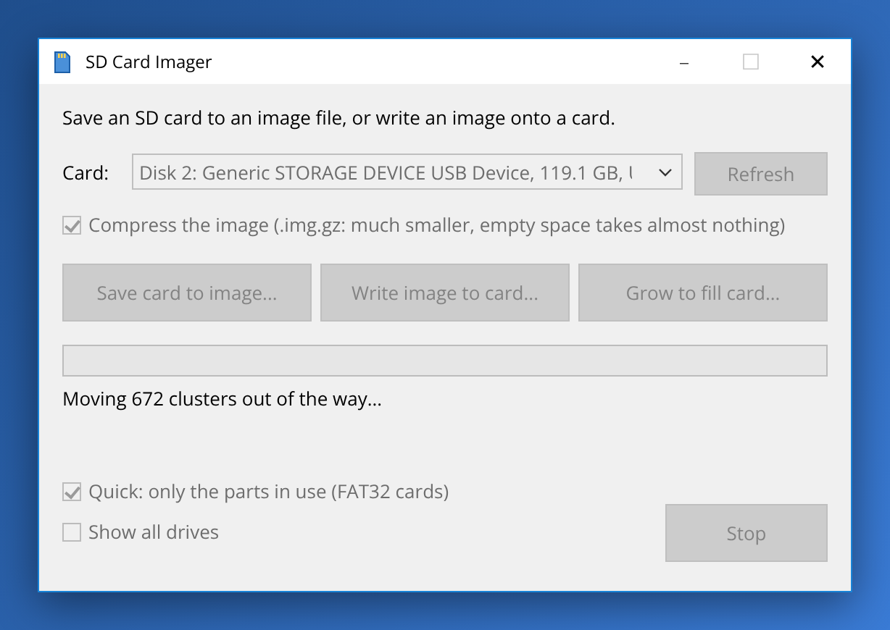
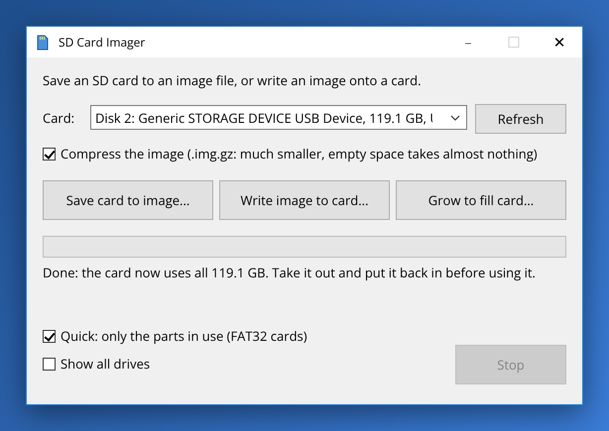
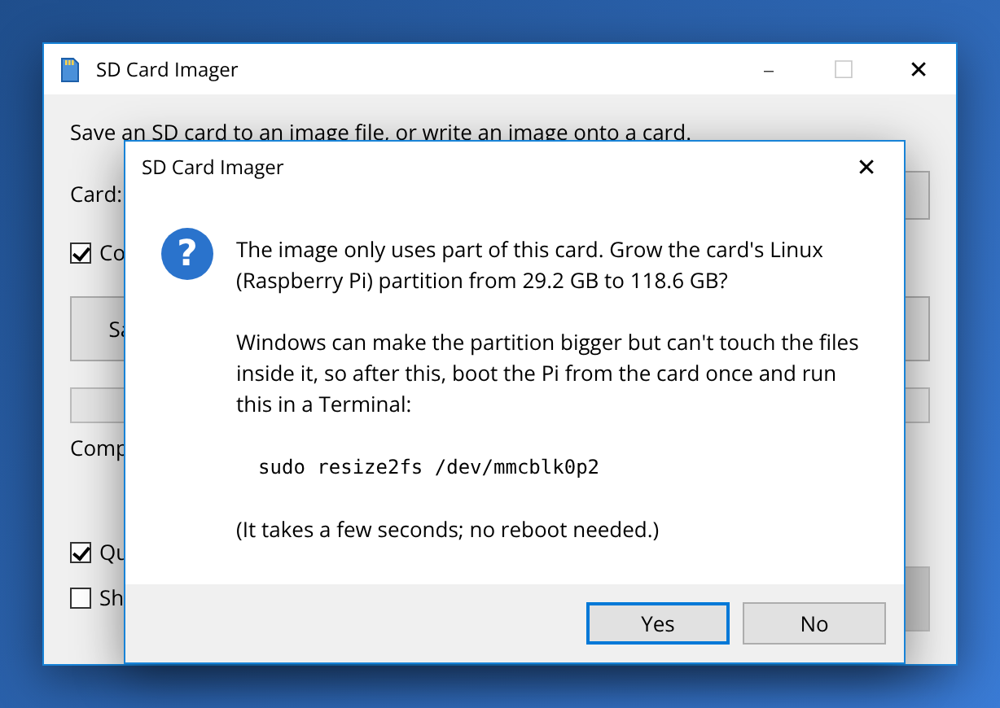

# SD Card Imager

A small Windows app that **saves a whole SD card to one image file**, **writes an image back onto a card**, and **grows a card to its full size** after you've copied a small card onto a bigger one.

It's fast 🏎️ because it skips a card's empty space instead of copying every byte.

Windows 10 or 11. Nothing to install: it's one PowerShell script and a launcher.

**[Download SD-Card-Imager.zip](../../docs/SD-Card-Imager.zip)**, unzip it, and double-click **SD Card Imager.cmd** (click *Yes* when Windows asks about admin rights, which it needs to read or write a whole card).



## What it's for

- **Backing up a card** before you try something risky: a new OS, an update, an experiment. Save the card, and if it goes wrong, write the image back.
- **Copying one card to another**: save the old card, then write the image onto the new one.
- **Moving to a bigger card**: write a 32 GB card's image onto a 128 GB card, then click **Grow to fill card** so the extra space can be used.
- **Raspberry Pi cards**: keep a ready-to-go image of a set-up Pi (apps installed, Wi-Fi set) and write it onto new cards in a few minutes.
- **The Shelf's microSD card**: back up the board's card (music, pictures, files) or move it to a bigger card.
- **Keeping spare copies**: compressed images are small, so you can keep several versions.

<a id="why-its-fast"></a>
## Why it's fast 🏎️

Most card imagers copy **every byte** of the card, even the parts that hold nothing. A 32 GB card with 3 GB of files still takes as long as a full one, and the image file is a full 32 GB.

SD Card Imager reads the card's own map of which parts are in use (the FAT table) and **skips the empty space** entirely:

- **Saving:** only the parts in use are read from the card. The empty parts become zeros in the image without touching the card.
- **Writing:** empty parts of the image are skipped on the new card instead of being written as zeros. Writing is the slow part on SD cards, so this saves the most time.
- **Compressed images:** empty space takes almost nothing in a `.img.gz`, so the file is about the size of what's actually on the card.

Example: a 32 GB card holding 3 GB of files, read at about 85 MB/s and written at about 30 MB/s:

| | Copying every byte | SD Card Imager (Quick) |
|---|---|---|
| Save the card | about 6 min | about 1 min |
| Write it to a new card | about 18 min | about 2 min |
| Image file size | 32 GB (`.img`) | about 3 GB (`.img.gz`) |

The emptier the card, the bigger the difference. *(Times are worked out from typical card speeds; your card and reader will vary.)*

Quick mode works on FAT32 cards and on the FAT32 part of any card. Other file systems, such as a Raspberry Pi's Linux partition, are copied in full so nothing is missed. Compression still shrinks their empty space in the image file.

## Features

| | |
|---|---|
| **Save a card to an image** | Exact copy as `.img`, or compressed `.img.gz` where empty space takes almost nothing (a 32 GB card holding 3 GB makes an image of about 3 GB). |
| **Quick mode** | On FAT32 cards it reads the card's own map of used space and skips the empty parts, both when saving and when writing. Much faster on cards that aren't full (see [Why it's fast](#why-its-fast)). |
| **Write an image to a card** | Takes `.img` and `.img.gz` files. Checks that the image fits, and asks you to confirm the card first. |
| **Grow to fill card** | Makes the last partition use the whole card. FAT32 grows completely in place, Raspberry Pi (ext4) partitions grow and then need one command on the Pi, and NTFS uses Windows' own resize. Offered automatically after writing an image onto a bigger card. |
| **Safe card list** | Only SD cards and USB drives are listed, never the computer's own disks. Extra warning for anything over 300 GB. |
| **Progress and Stop** | Shows how much is done, the speed and the time left. *Stop* ends any save or write. |
| **Nothing to install** | Plain PowerShell with Windows Forms, built into Windows 10 and 11. |

## Saving a card

1. Put the card in and pick it in the **Card** list (click **Refresh** if it's missing).
2. Leave **Compress** ticked for a small image file.
3. Click **Save card to image...** and choose where to save it.



## Writing an image onto a card

1. Put the new card in and pick it. **Check it's the right one: everything on it is replaced.**
2. Click **Write image to card...** and pick the `.img` or `.img.gz` file.
3. When it's done, take the card out and put it back in.



The new card must be at least as big as the one the image came from. If it's bigger, see the next section.

## Growing a card to its full size

An image carries the old card's partition sizes, so a 32 GB image written onto a 128 GB card still acts like a 32 GB card. The rest of the card sits unused.



After a write, if the card is bigger than the image, the app asks whether to grow it. You can also pick any card and click **Grow to fill card...** yourself.



**FAT32 cards** (The Shelf's card, cameras, most cards used as plain storage): everything happens in the app and takes about a minute. The card's file tables are enlarged, the few clusters in their way are moved, and every folder is updated, so your files stay exactly as they were.




**Raspberry Pi cards**: the app makes the Linux partition fill the card. Windows can't change the files inside a Linux partition, so boot the Pi from the card once and run this in a Terminal (a few seconds, no reboot):

```
sudo resize2fs /dev/mmcblk0p2
```

Or use `sudo raspi-config` → *Advanced Options* → *Expand Filesystem*.



**NTFS cards** grow with Windows' own resize. **exFAT** and **GPT** cards aren't grown: the app says so and changes nothing.

Keep the image you wrote until you've checked the grown card, just in case.

## Good to know

- *Stop* ends a save (the unfinished file is deleted) or a write (the card is left incomplete: write it again before using it).
- If the card is "in use", close any Explorer windows or programs showing files on it and try again.
- If no card shows up, the status line lists every disk Windows sees. Some built-in card readers don't call themselves removable: tick **Show all drives**.

## Files

| File | What it is |
|---|---|
| `SD Card Imager.cmd` | Double-click this to start the app. |
| `SD-Card-Imager.ps1` | The app itself (PowerShell, with the card code in C# inside it). |
| `README.txt` | Short instructions that travel with the zip. |
| `make-screenshots.py` | Draws the pictures on this page from the app's window layout (Python and Playwright). |

The screenshots are drawn from the app's exact window layout and real messages, using Open Sans in place of Windows' Segoe UI.
